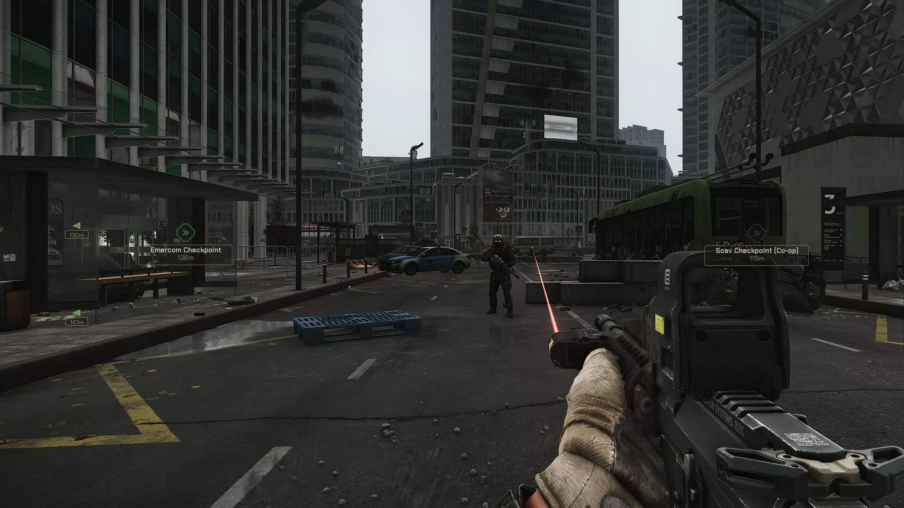

<div align="center">

# QuestMarkersLinux

**Quest markers for SPT on Linux — drawn on your desktop, not lost in the game UI.**

A transparent overlay that shows where your quest objectives, extracts, airdrops
and BTRs are, with a pin, a distance and an arrow at the screen edge when the
target is off-screen or behind you.

> **Requires a Wayland session.** The overlay is a native layer-shell client, so
> it draws nothing on X11 or XWayland — there you get a black screen instead of
> markers. KDE Plasma, GNOME and wlroots compositors all work.

[](https://github.com/Okamisan111/QuestMarkersLinux/actions/workflows/ci.yml)
[](LICENSE)


</div>

---

## What this is

SPT (Single Player Tushonka) runs on Linux through Wine or Proton. This project
gives you the quest-marker HUD you know from mods on Windows:

- a **BepInEx plugin** inside the game reads your active quest targets,
  extracts, airdrops and BTR positions;
- a **small Python program** (`overlay.py`) draws them as pins with labels,
  distances and edge arrows;
- a **native presenter** puts that drawing on your desktop with real
  transparency — a Wayland layer-shell surface the compositor blends for you.

It is a port inspired by **maschine's QuestMarkers** (MIT). Similar look, same
idea, rebuilt for Linux.



**Now with transparency and multi-monitor support!**

*In a raid: off-screen objectives appear as arrows at the screen edge, visible
ones as pins with name and distance.*

### Read this first

> **The plugin cannot draw anything by itself.**
> The markers are *not* rendered inside the game window. The plugin only sends
> data; `overlay.py` is what you actually see. If you press the toggle key and
> nothing happens, the overlay is almost certainly not running — see
> [Troubleshooting](#troubleshooting).

### What it is not

- Not affiliated with Battlestate Games or the SPT team.

---

## Requirements

| You need | Why | Check with |
|---|---|---|
| A **Wayland session** (KDE Plasma, GNOME, wlroots) | the overlay is a layer-shell client; on X11/XWayland it cannot be drawn at all | `echo $XDG_SESSION_TYPE` prints `wayland` |
| SPT 4.1 installed and running under Wine/Proton | the plugin lives inside the game process | you can play SPT |
| BepInEx 5 in your SPT folder | loads the plugin | `<SPT>/BepInEx/core/BepInEx.dll` exists |
| Python 3.10+ | runs the overlay | `python3 --version` |
| `pycairo` + `websockets` | drawing and the feed connection | pinned in `requirements.txt`, installed in a venv below |
| cairo dev headers + `pkg-config` | `pycairo` needs them to build | `pkg-config --modversion cairo` |
| `gcc` + `wayland-client` dev | builds the native presenter | `pkg-config --modversion wayland-client` |

`Better BepInEx` is **optional** and only affects the in-game settings menu (see
[Advanced settings](#advanced-settings-better-bepinex)).

---

## Quick start

Five commands from a fresh clone. Copy-paste friendly.

```bash
git clone https://github.com/Okamisan111/QuestMarkersLinux.git
cd QuestMarkersLinux

# 1) Python environment (local venv, nothing system-wide, no root)
python3 -m venv .venv
.venv/bin/pip install -r requirements.txt

# 2) build the native presenter
bash wayland/build.sh

# 3) your personal settings (feed token + monitor geometry)
cp config.example.json config.json
openssl rand -hex 16          # paste the output as "feedToken" in config.json

# 4) sanity check: demo markers on your desktop for 5 s, no game and no plugin
.venv/bin/python3 feed_sim.py &
.venv/bin/python3 overlay.py --feed logs/latest.json --seconds 5
```

**5) Install the plugin into SPT**

```bash
dotnet build plugin/ -p:SptPath="/path/to/your/SPT"
cp plugin/bin/Release/chaossan-questmarkerslinux.dll \
   "/path/to/your/SPT/BepInEx/plugins/"
```

**6) Put the same token into the plugin.** Start SPT once so the config file
appears, close the game, then edit
`<SPT>/BepInEx/config/com.chaossan.questmarkerslinux.cfg`:

```ini
[General]
Feed Token = <the same value you put in config.json>
```

Now start the game, start the overlay, and press **I** in a raid:

```bash
.venv/bin/python3 overlay.py --feed ws://127.0.0.1:9378
```

That's it. The overlay waits for the feed and shows markers on its own when a
raid starts.

---

## The daily loop

```bash
# terminal 1 (or a launcher, or autostart — see below)
cd /path/to/QuestMarkersLinux && .venv/bin/python3 overlay.py

# then: launch SPT → enter a raid → press I
```

- **I** toggles the marker set you ticked in the plugin config.
- The second key (unbound by default) has its own marker list.
- Markers vanish automatically when the feed goes quiet (game closed, raid
  over, plugin error) — a crashed game can never leave frozen pins on screen.

### Start it without a terminal

The plugin runs inside Wine and cannot start Linux programs. Start the overlay
yourself — it is a single script, no service, no wrapper:

```bash
nohup .venv/bin/python3 overlay.py >> logs/overlay.log 2>&1 &

pgrep -f overlay.py            # is it running?
tail -f logs/overlay.log       # what is it doing?
pkill -f "python3 overlay.py"  # stop it
```

Put that `nohup` line in your desktop autostart and you never see a terminal.

---

## Settings

### Plugin config

`<SPT>/BepInEx/config/com.chaossan.questmarkerslinux.cfg` — sections
**General**, **Display**, **Filter**, **Debug**. Stock BepInEx has no in-game
menu; edit the file (game closed, see [Token changes](#the-feed-token)).

| Setting | Default | What it does |
|---|---|---|
| `General / Enabled` | on | stream the feed at all |
| `General / Toggle key` | **I** | show/hide markers during a raid |
| `General / Toggle key shows` | Quests, Extracts, Airdrops, BTR | what that key marks |
| `General / Second key` | *(unbound)* | a second hotkey with its own list |
| `General / Second key shows` | Extracts | what the second key marks |
| `General / Show at raid start` | on | show the toggle key's markers automatically |
| `General / Feed Port` | 9378 | loopback WebSocket port |
| `General / Feed Token` | *(empty)* | shared secret, see [security](#the-feed-token) |
| `General / Feed Hz` | 60 | frames per second sent by the plugin (1–180) |
| `Filter / Maximum Distance` | 0 (no cap) | hide everything farther than this |
| `Filter / Maximum Quest Markers` | 16 | closest objectives win |
| `Display / Show Labels` | on | marker name next to the pin |
| `Display / Show Distances` | on | e.g. `885m` / `1.1km` |
| `Display / Edge Arrows` | on | off-screen targets as border arrows only |
| `Display / Auto-hide after` | 6 s | peek markers hide themselves again |
| `Display / Marker Size` | 1.0 | 0.5 = half size |
| `Display / Far Distance` / `Far Scale` | 300 m / 0.6 | distant markers shrink |
| `Display / Imperial Units` | off | feet and miles |
| `Display / Edge Arrow Size` | 24 px | arrow size at scale 1.0 |
| `Display / Icon Scale` | 1.0 | symbol size multiplier |
| `Display / Marker Opacity` | 0.35 | see-through markers, 1.0 = fully opaque, 0.05 = watermark, see [semi-transparent markers](#semi-transparent-markers) |
| `Debug / Debug Log` | off | verbose scan/feed logging |

#### Advanced settings (Better BepInEx)

With [Better BepInEx](https://sp-mod.com/mod/3207/better-bepinex) the following
are tagged **advanced** and hidden behind its advanced view: `Feed Port`,
`Feed Hz`, `Edge Arrow Size`, `Debug Log`. The `Feed Token` is deliberately a
normal setting — you need it on first setup.

This tagging only exists in Better BepInEx. Stock BepInEx just shows you the
plain `.cfg`, where nothing is hidden.

### Overlay config

`config.json` next to `overlay.py` (or `--config PATH`). It is **not** in the
repository on purpose — it carries your feed token.

```json
{
  "feed": "ws://127.0.0.1:9378",
  "hz": 120,
  "smooth": 0.045,
  "labels": true,
  "distance": true,
  "edge": true,
  "scale": 1.0,
  "farDistance": 300.0,
  "farScale": 0.6,
  "imperial": false,
  "edgeSize": 24,
  "iconScale": 1.0,
  "markerAlpha": 1.0,
  "feedToken": "your-own-random-value"
}
```

| Key | Default | Meaning |
|---|---|---|
| `feed` | `ws://127.0.0.1:9378` | feed source: `ws://…` or a `latest.json` path |
| `hz` | 120 | **render** rate; the plugin's data rate is `Feed Hz` |
| `smooth` | 0.045 s | seam blending of the motion interpolator (0 = raw) |
| `labels`, `distance`, `edge` | true | mirrors the plugin display options |
| `scale`, `farDistance`, `farScale`, `iconScale` | 1.0 / 300 / 0.6 / 1.0 | sizes |
| `edgeSize` | 24 | edge arrow size in px |
| `markerAlpha` | 1.0 | overlay-side dimmer, multiplies the plugin's `Marker Opacity` |
| `imperial` | false | feet/miles |
| `geometry` | null | override the surface placement |
| `monitor` | null | which screen to draw on — same four forms as `--monitor` |
| `feedToken` | — | shared secret, must equal the plugin's `Feed Token` |

The file is read once at overlay start. A UTF-8 BOM is fine; a broken file
prints one warning and the overlay continues with defaults. Booleans are
strict (`"labels": "no"` really means off), unknown keys are ignored, `hz` is
clamped to 1–300.

**Font:** labels use *Chakra Petch* if fontconfig finds it, otherwise your
system font. Install it (Arch: AUR `ttf-chakra-petch`; elsewhere:
fonts.google.com, SIL OFL 1.1) or set `"font": ""` to use the system font on
purpose.

### Semi-transparent markers

Two knobs multiply: the plugin's `Display / Marker Opacity` (0.05 … 1.0, default
0.35, sent as `op` in every marker) and the overlay's `markerAlpha` in
`config.json` (default 1.0, so the shipped look is the plugin value alone). The
overlay then gives every part of a marker its own share of what is left,
`layer alpha = 1 − (1 − opacity) × weight`:

| part | weight | at opacity 0.45 (measured in the composited marker) |
|---|---|---|
| tagbox background, pin fill | 1.00 | A115 — this is what actually opens up |
| 1 px outlines (tagbox, pin, edge arrows) | 0.50 | A216 |
| kind icon strokes / accent | 0.30 | A213 |
| distance text | 0.08 | A244 |
| quest label | 0.00 | A255 (A249 … A253 while a marker moves, sub-pixel resampling) |

At the shipped default 0.35 those weights land at A89 for the tagbox plate and
the pin fill, A172 for the outlines, A205 for the kind icon, A242 for the
distance text and A255 for the quest label (tier formula, not a screen
measurement - the 0.45 column above was read off the composited marker).

A flat 1:1 fade would wash the text out before the background becomes
see-through, so text and outlines are deliberately protected. `op = 1.0`
(raise the knob to it; it is also what a plugin older than 1.2.2 sends, because
it sends no `op` at all) reproduces the previous fully opaque look pixel for
pixel. Below `op = 0.01` a marker is dropped instead of drawn invisibly, and
hostile config values are clamped on both sides. An existing BepInEx config keeps
whatever value it already wrote, so an install that ran 1.2.1 once still reads
`Marker Opacity = 1` until the entry is deleted or lowered.

Measured on KWin/KDE with the Wayland presenter, covered and above native
resolution. On a compositor that blends layer surfaces differently the result
can look washed out — raise the opacity or set `markerAlpha` back to 1.0.
Cost at default opacity is unmeasurable (2.80 → 2.81 ms per frame at 64
markers); rendering while translucent costs about 20 % more of that frame time,
and the wire grows by ~9 bytes per marker per frame.

### Two screens, one overlay: picking the monitor

`wayland_present --list` now asks the compositor for every connected output and
`overlay.py` reads that list once at startup. What it does with it depends on
how many screens there are:

| Situation | Behaviour |
|---|---|
| one monitor | uses it, no question asked (single-monitor setups behave exactly as before) |
| several monitors, no setting | asks once, in the terminal it was started from: `[0] … [1] …`, answer with a number, a name or a position; Enter takes the first one |
| several monitors, started without a terminal (Lutris, a .desktop launcher, a service, CI) | never blocks on a prompt: uses the compositor default output and prints which screens exist plus the value to pin |
| a monitor named that does not exist | refuses to start and prints the real list — a typo must not draw markers on the wrong screen |

Pin the screen with `--monitor` (or `"monitor"` in `config.json`). Four forms
work, and they are exactly what `overlay.py --list-monitors` prints:

```bash
overlay.py --list-monitors             # what is connected, and what to type
overlay.py --feed ws://127.0.0.1:9378 --monitor 1          # probe index
overlay.py --feed ws://127.0.0.1:9378 --monitor DP-1       # wl_output name
overlay.py --feed ws://127.0.0.1:9378 --monitor ULTRAGEAR  # description fragment
overlay.py --feed ws://127.0.0.1:9378 --monitor 2560,0     # layout position
```

KWin sends no `wl_output` name at all, so on KDE the useful values are the
probe index (`--list-monitors` shows `[#0] …`) or a fragment of the monitor's
description (`ULTRAGEAR`, `24G2`). A compositor that reports connector names
(wlroots-based ones) can be pinned by name, which survives a replug — layout
offsets do not.

The surface size follows the chosen screen. The old hardcoded 2560×1440 frame
overshot a 1920×1080 second monitor by the whole difference; now the overlay
asks the monitor how big it is, and `geometry` stays available as an explicit
override.

### Command line

| Flag | Purpose |
|---|---|
| `--feed URL_OR_FILE` | feed source |
| `--config PATH` | alternate config file |
| `--geometry WxH+X+Y` | surface placement (default fullscreen at 0,0) |
| `--monitor SPEC` | which screen to draw on: `1` / `#1`, `DP-1`, `ULTRAGEAR` or `2560,0` |
| `--list-monitors` | print what the compositor reports and exit |
| `--hz N` | render rate |
| `--smooth S` | seam blending |
| `--debug` | per-frame feed stats every 2 s |
| `--trace FILE.jsonl` | log every incoming frame (capped at 64 MiB) |
| `--seconds N` | stop after N seconds (default: run until Ctrl-C) |
| `--feed-token T` | token override (prefer `config.json`) |
| `--insecure` | allow a `ws://` feed with no token (dev only) |

---

## The feed token

The feed server listens on `127.0.0.1` only — but "loopback only" is not
"private". Without protection, any local process — and *any web page you open
in a browser*, because WebSocket handshakes are not blocked by CORS — could
read your live quest positions or kick the overlay out of the server's single
client slot.

So the feed has a shared secret, and both sides must hold it:

1. **The token is never transmitted.** Not in the URL, not in a header, not in
   a frame. Instead the server proves it knows the token, then the overlay
   proves it back — two different HMAC-SHA256 values over a fresh random nonce.
2. **Echoing is not enough.** The client's answer is derived differently from
   the server's proof, so a process that simply replays what it received is
   refused.
3. **Every frame is stamped** with an HMAC over that frame's own timestamp,
   checked in constant time. A frame cannot be replayed under another
   timestamp, and reading the feed never reveals the token.
4. **Browsers are shut out** regardless: handshakes carrying an `Origin`
   header get `403` before any upgrade.
5. **Only an authenticated client gets the slot.** An unauthenticated
   connection waits 8 s and is dropped; it can never evict your overlay.

If you leave `Feed Token` empty, the feed is unauthenticated (any local
process can read it) — the plugin logs a warning at startup. The overlay
refuses a `ws://` feed without a token unless you pass `--insecure`.

### Token changes

A token change is never hot, and the order matters:

```
close the game  →  edit both sides to the same value  →  start the game  →  start the overlay
```

The plugin reads its config at **game** start, the overlay reads
`config.json` at **overlay** start. BepInEx also rewrites its `.cfg` on exit,
so an edit made while the game is running can be silently undone. Wrong order
= redial loop with a clear message in the log, never silent wrong data.

Keep `config.json` out of git — that is why it is ignored and only the
placeholder `config.example.json` is tracked.

---

## Troubleshooting

| Symptom | Cause | Fix |
|---|---|---|
| Black screen instead of markers | you are on X11 / XWayland | log in to a Wayland session — this is a layer-shell overlay and cannot draw on X11 |
| Nothing appears, ever | overlay not running | start `overlay.py`, check `pgrep -f overlay.py` |
| Keys do nothing | you pressed **I** without an overlay | the key only toggles what the overlay draws |
| `ws feed: ... (retry in 2 s)` forever | token mismatch or old plugin | same token on both sides, restart **game first**, then overlay |
| `server could NOT prove knowledge of the feed token` | something else owns port 9378, or the token differs | close the squatter / align the tokens |
| `refusing an unauthenticated ws:// feed` | no token, no `--insecure` | set a token (recommended) or pass `--insecure` for dev |
| Markers misplaced after a resolution change | surface size changed | handled live via `presenter: configured WxH`; on a **rotated** screen markers are clipped by design (one honest warning is printed) |
| `presenter keeps dying - giving up` | the compositor refused the layer-shell surface (unsupported protocol, or not a Wayland session) | read the log line right before the deaths; the overlay needs a Wayland session, not XWayland |
| Labels in a boring font | Chakra Petch not installed | install it or set `"font": ""` |
| Markers freeze on screen | feed went quiet > 1 s | expected: the overlay clears itself; check the game/plugin log |
| Feed works, markers jitter | very low game FPS | the smoother interpolates real measurements; lower `hz` rarely helps, see [Under the hood](#under-the-hood) |
| Markers look washed out or too faint | `Marker Opacity` at its 0.35 default (or lower), `markerAlpha` lowered, or a compositor that blends layer surfaces differently | raise `Marker Opacity` to 1.0 for the fully opaque look; the tier table is in [semi-transparent markers](#semi-transparent-markers) |
| Markers appear on the wrong monitor | several outputs and no monitor pinned | `overlay.py --list-monitors`, then `--monitor` (or `monitor` in `config.json`) with the value it prints |

Still stuck? `--debug` gives per-frame stats, `--trace out.jsonl` gives every
raw frame — that is enough to tell a feed problem from a drawing problem.

---

## Under the hood

Three parts, one direction of data flow:

```
SPT + BepInEx plugin  ──ws://127.0.0.1:9378──▶  overlay.py  ──shared memory──▶  presenter
   (Wine process)                                (Linux)                         (Wayland)
```

**The plugin** (`plugin/src/`) scans quest targets, extract points, airdrops and
BTR trains, projects them to normalized screen coordinates (`nx`, `ny`, plus a
`behind` flag), and pushes one JSON frame per `Feed Hz` tick. The frame head is
built first and each marker is measured in real UTF-8 bytes before it enters
the array, so a frame always fits the 8 KiB send buffer — and because markers
are distance-sorted, the ones that get dropped when a frame is full are the
*far* ones.

**The overlay** (`overlay.py`) sanitizes the frame at the provider boundary
(viewport, marker count 128, label length 160, every coordinate and feature
clamped), interpolates motion, composites overlapping markers in Python, and
sends dirty rects to the presenter. Feed frames older than **1 second** clear
the display.

**The presenter** (`wayland/wayland_present.c`) is a tiny C program: a
layer-shell surface with per-pixel alpha that the compositor blends. It
copies rects with `memcpy`, bounds each rect to one full surface and a full
frame to 2× that, and exits fail-closed on a desynced header instead of
guessing. If it dies, the overlay respawns it (5 tries per death, at most 50
deaths per run).

### Motion: why not a plain smoothing filter

Feed positions arrive at the game's frame cadence, which is a staircase. A
classic exponential smoother re-accelerates toward every step and micro-stops
before the next one — visible jitter that gets worse as a marker gets close.
So the overlay uses a **delayed chord interpolator**: it always draws a point
on the chord between the last two *real* measurements, evaluated at render
time.

- display trails the newest measurement by one interval (~33 ms at 30 Hz) —
  constant, invisible;
- velocity is constant between measurements, so no pulsing (measured on real
  Shoreline data: display-velocity pulses up to 3.5× true speed at 26–56 m
  before, median 0.14–0.20 of true speed after);
- close-range parallax lag drops from ~34 px to ~11 px at 4 m;
- no extrapolation: a standing marker is rock-steady, reversals overshoot ≤ 3 px,
  and a feed gap > 300 ms snaps instead of crawling.

Seam blending (`smooth`, default 0.045 s, overlay side only) softens direction
changes at chord boundaries and is capped so it never trails more than ~6 px
at speed. `tests/test_smooth.py` contains the staircase test that proves the
old stutter and the fix.

### Things that are deliberately not drawn

Markers behind the player are never mirrored onto the screen. They become an
edge arrow at the nearest border side, or nothing if `Edge Arrows` is off, and
re-enter the view at their real position when you turn around.

### Distances

Metric: `885m`, `1.1km`. Imperial: `4921ft` below 1609 m, `1.2mi` from there
(1 mi = 5280 ft).

---

## Testing

Everything is a plain script with a `RESULT:` line — no pytest, no fixtures:

```bash
.venv/bin/python3 tests/test_feed_auth.py        # overlay side of the handshake
.venv/bin/python3 tests/test_plugin_ws.py        # the REAL C# server (needs dotnet)
.venv/bin/python3 tests/test_feed_hardening.py   # sanitizer, caps, log masking
.venv/bin/python3 tests/test_frame_rects.py      # geometry
.venv/bin/python3 tests/test_alpha.py            # opacity tiers, hostile values
.venv/bin/python3 tests/test_monitor.py            # monitor probe, picking, prompt
.venv/bin/python3 tests/test_plugin_labels.py    # objective index (needs dotnet)
.venv/bin/python3 tests/test_smooth.py           # interpolation
```

`tests/test_plugin_ws.py` is the interesting one: it compiles the production
`plugin/src/WsServer.cs` unchanged into a small console harness
(`tests/plugin/`), because the real plugin references BepInEx and UnityEngine
DLLs that cannot be shipped or built in CI. The wire protocol is therefore
tested for real, including the negative cases: wrong answer, echoed answer,
silent client, browser `Origin`, oversized headers, takeover.

CI runs all of it on every push (`.github/workflows/ci.yml`), plus the
presenter build with a checksum artifact.

---

## Project layout

```
overlay.py                  the overlay: feed client, renderer, presenter driver
feed_sim.py                 synthetic raid feed for developing without the game
config.example.json         template for your own config.json (not committed)
plugin/
  src/Plugin.cs             BepInEx entry point, scanning, frame building
  src/WsServer.cs           minimal RFC6455 server + v4 feed authentication
  src/BridgeScanner.cs      target discovery
  bin/Release/*.dll         prebuilt plugin (built from src/, see Quick start)
wayland/
  wayland_present.c         native presenter (Wayland layer-shell)
  build.sh                  builds it, vendored protocol XML
docs/example.webp           the screenshot above
tests/                      the test batteries above
tools/                      trace replay/report helpers
```

---

## FAQ

**Do I need to run the overlay every time?**
Yes. One script, autostart it once and forget it.

**Can the plugin start the overlay itself?**
No — the plugin lives inside the Wine process and cannot launch Linux programs.

**Does this work on X11 / XWayland?**
No, and deliberately so: the overlay is a Wayland layer-shell client. Under
XWayland a depth-32 window is refused and a depth-24 window cannot carry
alpha, which is exactly the black screen X11 users hit. Use a Wayland
session (KDE, GNOME and wlroots compositors all work).

**SPT just updated — will the mod break?**
A game update can change the classes the plugin reads. Rebuild the plugin
against the new install (`dotnet build plugin/ -p:SptPath=…`) and re-copy the
DLL; the overlay is independent of the game version.

**Are my positions sent anywhere?**
No. Everything is on your machine, over loopback, and the token is never
transmitted.

---

## License & credits

MIT — see [`LICENSE`](LICENSE).

The marker design, icon set and visual language are adapted from
**maschine's QuestMarkers** (MIT, <https://sp-mod.com/mod/2954/quest-marker>).
Thank you, maschine, for the mod and for blessing this port.

Labels use the system font **Chakra Petch** (SIL Open Font License 1.1); the
font itself is not shipped here. Rendering uses cairo.

Unofficial community port for Linux/Proton play, not affiliated with or
endorsed by Battlestate Games.
